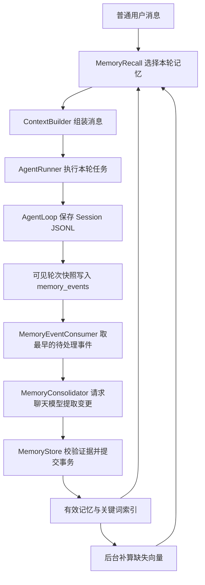

# Nano Agent 的长期记忆机制

长期记忆让同一工作区中的不同会话共享用户偏好、稳定事实和已确认的项目决策。一次普通对话会在两个时刻使用它：**回答前**，根据本轮用户原文召回少量有效记忆；**会话保存后**，后台判断这一轮是否提供了值得长期保留的新信息。两者之间以 SQLite 中的有效记忆为准，所以用户发出更正后，当前对话已经有更正原文，其他会话则要等后台事务提交后才能召回新版本。

## 一次对话怎样经过记忆系统



普通用户轮次开始时，`AgentLoop` 调用一次 `recall(current_message.content)`。有召回结果时，`ContextBuilder` 将它放在系统提示词末尾的 `## Long-term Memory` 节。之后依次是可选的会话摘要（独立的 `HumanMessage`）、近期历史和本轮用户原文。同一轮里的多次工具调用复用这次召回。来源为 `cron`、`subagent`、`goal` 的内部轮次跳过这条长期记忆读写路径。[轮次入口与保存](../nanobot/agent/loop.py) · [消息组装](../nanobot/agent/context.py)

## 一条记忆如何建立、更正和撤回

以下用示例 ID 跟踪一项决定。会话 A 中，用户说“这个项目用 Redis 缓存”。轮次保存成功后，后台取得事件 `10`。快照里第 `0` 条可见消息是这句用户原文。聊天模型可以提出如下变更：

```json
{
  "operations": [
    {"op": "add", "kind": "decision", "scope": "project", "text": "项目使用 Redis 缓存。", "message_offset": 0}
  ]
}
```

程序验证后写入记忆 `41`。后来会话 B 中，用户在事件 `17` 的第 `2` 条可见消息明确说“改用本地缓存”。预算充足时，后台把本轮快照和全部有效记忆的 ID、类型、正文发给模型。即使这句话没有提到 Redis，模型也有机会找到 `41`，提出 `replace(target_id=41)`。提交后可以看到两个版本：

| 记忆 ID | 正文 | 状态 | 建立证据（事件，位置） | 替代的旧 ID | 结束证据（事件，位置） |
| --- | --- | --- | --- | --- | --- |
| 41 | 项目使用 Redis 缓存。 | `superseded` | (10, 0) | 空 | (17, 2) |
| 42 | 项目使用本地缓存。 | `active` | (17, 2) | 41 | 空 |

同一句更正既是旧条目失效的证据，也是新条目成立的证据。另一个会话询问当前方案时，召回候选只包括有效版本。如果用户随后明确撤回这项决定，`retract(target_id=42)` 会把 `42` 标记为 `retracted`，并记录撤回原文的位置；`41` 保持已替代状态。

### 模型判断什么，程序校验什么

- **模型判断语义。** `kind` 可以是 `preference`、`fact` 或 `decision`，`scope` 可以是 `user` 或 `project`。整理提示词要求保留长期有效的信息，例如“以后默认用中文回答”；“这次用英文”属于单轮要求。模型通过非流式 `complete(..., response_schema=...)` 返回操作数组。合法的 `{"operations":[]}` 表示整理完成且无变更。[整理实现](../nanobot/memory/consolidator.py)
- **程序校验结构、位置和状态。** Pydantic 校验字段及类型；每项操作的 `message_offset` 必须在当前快照范围内，并指向用户消息。更正和撤回只能引用本批开始前有效的 ID，同一批的一个目标只能使用一次。位置校验能证明“这句话确实出自用户”，结论是否准确仍需对照原文。[操作模型](../nanobot/memory/models.py) · [写入校验](../nanobot/memory/store.py)
- **数据库保证整轮一致。** `apply()` 在同一事务内完成版本更新、FTS 索引变更和事件确认。一项操作无效会回滚整批。部分唯一索引限制有效条目的 `(scope, kind, text)`：重复新增相同正文会跳过，更正后若与另一有效条目完全重复则整轮回滚。不同措辞是否表达同一事实，由整理模型判断。[事务实现](../nanobot/memory/store.py)

## 数据放在哪里，怎样核对原文

每个工作区使用一个 `<workspace>/memory/memory.sqlite3`。当前实现面向单用户；`scope` 描述一条记忆的适用范围，实际的数据隔离单位是工作区。

| 表或索引 | 一行表示什么 | 谁使用它 |
| --- | --- | --- |
| `memory_events` | 一个进入整理队列的轮次，含 `session_key`、可见消息的 JSON 数组、创建时间和 `processed` 标记 | 消费者按 ID 顺序读取待处理事件；已处理的快照继续用于核验 |
| `memories` | 一条记忆的一个版本，含类型、范围、正文、状态、建立与结束证据、前一版本 ID | 整理器读取有效候选；召回和 `/memory` 使用有效条目 |
| `memories_fts` | 一个有效版本的分词结果，`rowid` 对应 `memories.id` | SQLite FTS5 执行关键词查询；条目失效时同步移出索引 |
| `memory_embeddings` | 一条记忆在一个模型空间中的归一化向量，按 `(memory_id, model_key)` 唯一 | 语义召回按当前模型查询，并关联 `memories` 筛选有效版本 |

**证据坐标是 `(event_id, message_offset)`。** 入队时先过滤不可见消息，再把剩余消息按顺序保存。位置从 0 开始，直接对应 `memory_events.messages` 的数组下标。即使原会话已清空或删除，快照仍能核验。用户输入 `/memory` 可以看到有效条目和类似“事件 17 · 消息 2（会话 B）”的来源；该命令按 ID 从新到旧列出，显示内容默认限长 4000 个字符。[数据存储](../nanobot/memory/store.py) · [命令实现](../nanobot/agent/commands.py)

例如，下面的只读查询将指定记忆版本与建立它的用户原文一起取出。在支持绑定参数的 SQLite 客户端中，将 `:memory_id` 绑定为要核验的 ID：

```sql
SELECT m.id, m.status, m.text, e.session_key, e.id AS event_id, m.message_offset,
       json_extract(e.messages, '$[' || m.message_offset || '].content') AS evidence
FROM memories AS m
JOIN memory_events AS e ON e.id = m.event_id
WHERE m.id = :memory_id;
```

若要找“上次具体讨论了什么”，使用 `search_sessions` 查找匹配的会话，再将命中的 `session_id`、`revision` 和 `message_index` 交给 `read_session`。这里的 `message_index` 指向会话原文，长期记忆的 `message_offset` 指向单个事件快照。会话压缩则用 `summary_until` 记录本会话已经总结到哪里。[会话历史工具](../nanobot/tools/builtin/session_history.py) · [会话压缩机制](SESSION_COMPACTION.md)

## 回答前怎样选择记忆

### 关键词与语义两路取候选

| | 关键词检索 | 向量检索 |
| --- | --- | --- |
| 输入 | 索引和查询共用 `keywords()`。中文用 jieba 搜索模式切词，随后过滤完整停用词；`runner.py` 同时保留完整标识、`runner` 和 `py` | 用查询原文生成 embedding，每次输入最多取前 8192 个 UTF-8 字节，并舍去末尾不完整字符 |
| 查找 | 查询词去重，最多取 64 个，用 `OR` 查询 FTS5。优先命中含点或下划线的完整标识，同组按 BM25 排序 | 在进程内扫描当前模型的有效向量。记忆与查询向量都已归一化，等维向量的点积即余弦相似度 |
| 返回 | 排名前 20 的记忆 ID | 余弦相似度至少 0.52，再按相似度取前 20 个 ID |

两路按顺序执行，独立取候选。只要查询分词后有有效词，关键词零命中也会尝试语义召回。例如“怎样避免用户看到旧值”可以通过语义找到“先写数据库，再删除 Redis 缓存”。当查询只剩停用词，或没有可用词时，直接进入用户偏好选择。查询命中常见凭据格式、未配置 embedding、缺少当前模型向量或查询服务失败时，语义路返回空列表。[分词与语义检索](../nanobot/memory/recall.py) · [FTS 查询与有效向量读取](../nanobot/memory/store.py)

### 怎样合并排名和使用预算

采用等权的倒数排名融合（RRF）。每个 ID 在一路中排第 `r` 名，就得到 `1 / (60 + r)` 分，两路贡献相加。例如某条决策两路都排第 2，得分约 `0.0323`；只在一路排第 1 的条目得分约 `0.0164`。融合仅使用名次。最终按融合分从高到低排序，同分优先较大的记忆 ID。

向量请求返回后，程序再读取一次有效记忆，避免等待网络期间被撤回的记录进入上下文。默认总预算为 **1024 个估算 token**：先从新到旧放入 `scope=user` 且 `kind=preference` 的条目，这一步最多使用 **128 token**；再按融合排名填充，跳过已选 ID。每次只放整条，当前条目过长时继续尝试下一条。因此“谢谢”仍可能带上“默认用中文回答”，而用户在 `/memory` 看到一条记忆，也不意味着每轮都会注入它。[筛选与预算](../nanobot/memory/recall.py)

## 后台进度、故障和配置

整理输入按聊天模型上下文窗口减去默认输出预留计算，并计入系统指令、JSON 和结构化输出 schema。完整请求超出预算时，整理器仅缩小发给模型的输入，SQLite 中的事件快照仍保留完整原文。

1. 先从新到旧选择能完整放下的用户消息，再为过长的用户消息尝试保留首尾摘录。摘录标记为 `truncated`。模型只能看到所选文字，省略部分的偏好或决定可能漏记。
2. 在剩余预算内放入完整的有效记忆。用已选的最近用户消息做本地关键词检索，优先放入命中的候选，其余按 ID 从新到旧补充。随后尝试放入助手回复，再放工具结果。
3. 所选消息恢复为原始顺序，沿用快照中的 `message_offset`。每项变更必须引用本次输入里出现的用户消息；更正和撤回还必须引用模型见过的候选 ID。

| 情况 | 当前行为 |
| --- | --- |
| 普通轮次保存成功 | 先写 Session JSONL，再将可见轮次快照入队并唤醒消费者。系统提示词和会话摘要不进入快照。快照命中常见凭据格式时整轮跳过长期记忆入队；原会话仍按会话机制保存 |
| 进程在会话保存后、事件入队前退出 | 两次写入之间存在窗口，该轮可能漏记。已经入队的事件则能在重启后继续处理 |
| 裁剪后仍超预算，或原有用户证据全部被裁掉 | 跳过模型调用，将该事件标记为已处理。完整快照保留，消费者继续下一条。以后调大预算也不会自动重试已跳过的事件 |
| 模型输出截断、响应无效或事务失败 | 队首保留为待处理。启动或下次入队时重试；持续失败的队首会阻塞后续轮次 |
| 新条目提交后尚无向量 | FTS 立即可查。消费者结束本次事件消费后，用当前模型按每批最多 10 条补算缺失向量。网络请求在事务外，写回时再次确认条目有效 |
| 向量服务故障或更换模型 | 补算失败留待后续唤醒。模型空间按协议、服务地址和模型名生成标识；更换后会为有效条目补建新空间的向量。已有关键词索引仍可用 |

正常运行只需 SQLite 的 FTS5 支持和 jieba 即可进行本地关键词召回。要同时启用语义路，在 `nanobot.json` 的 `memory.embedding` 下填写 `type`、`api_base`、`model`、`api_key`。项目示例使用 `openai_compat` 和千问 `text-embedding-v4`。启用后，配置的 embedding 服务接收待索引的记忆正文及需要语义检索的查询。聊天 Provider 单独负责后台整理，接收本轮快照和有效候选。两套配置可独立选择。[示例配置](../.nanobot/nanobot.example.json) · [向量适配器](../nanobot/providers/embeddings.py) · [后台消费者](../nanobot/memory/consumer.py)

### 如何验证

在仓库根目录运行以下离线测试，可覆盖跨会话更正、无效证据回滚、超预算轮次整理及原文保留、关键词索引重建、两路独立召回和向量故障降级：

```shell
python -B -m unittest tests.memory.test_store tests.memory.test_consolidator tests.memory.test_recall
```

配置千问凭据后可在 PowerShell 显式运行在线测试。它使用临时工作区和合成文本，验证关键词零命中的改写问法能否召回正确决策，以及无关问题能否返回空结果。余弦门槛是当前模型的初始取值，切换 embedding 模型时可用这组样例重新验证。[在线用例](../tests/memory/test_recall_live.py)

```powershell
$env:RUN_QWEN_LIVE_TESTS = '1'
python -B -m unittest tests.memory.test_recall_live
```
