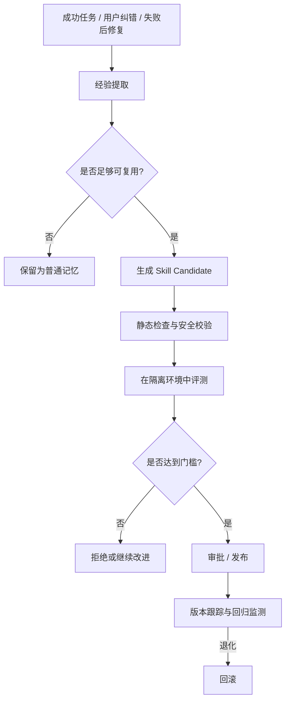
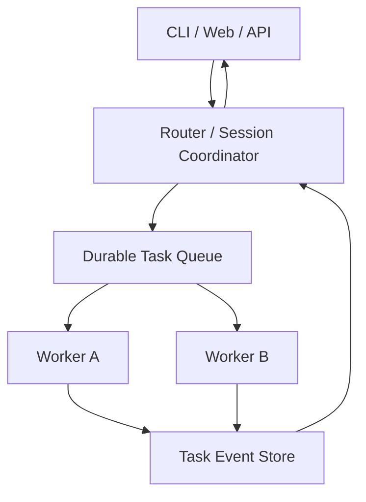

# Nano Agent 技术升级规划与实施路线图

> **用途**：作为后续与 Codex 讨论、设计、实施和验收的长期技术文档。  
> **项目仓库**：[nico-hua/nano-agent](https://github.com/nico-hua/nano-agent)  
> **文档性质**：技术规划 / 待验证设计，不代表所有功能已经实现。  
> **主要目标**：将 Nanobot 复现项目升级为**可扩展、可恢复、可评测、可积累经验的轻量级 Agent Harness**，兼顾 AI 应用开发与后端实习面试的技术深度。

---

## 0. 给 Codex 的阅读与执行约定（必读）

本文件是**方向性技术规划**，不是要求一次性完成的开发任务清单。开始任何改动前，Codex 必须遵循：

1. **先读代码，再判断需求**：核实仓库的真实目录、类、调用关系、已有功能、测试与运行方式。文中提到的现状来自此前讨论，可能与最新代码不一致；不得直接假定代码仍是该状态。
2. **先审计、后设计、再编码**：第一轮仅输出「现状映射、问题证据、实现候选方案、依赖和风险」，不要未经确认大规模重构。
3. **增量交付**：按里程碑拆分小 PR，每次只解决一个问题；优先复用现有抽象，避免为规划中的远期能力提前创建空模块。
4. **行为兼容**：保留已有 CLI、Web、API、会话格式、工具调用和 Skill 行为；必须破坏兼容时，先说明迁移方案。
5. **测试驱动与基准对比**：每个优化必须有可复现的验收测试；性能类改进需与改造前基线比较，不得只报告主观体验。
6. **不要堆技术栈**：优先 Python `asyncio`、SQLite、Pydantic、pytest、Ruff；不为了简历引入 Kafka、Kubernetes 或复杂微服务。
7. **安全边界优先**：模型生成的代码、Skill、工具参数均视作不可信输入；权限、沙箱、超时、审计不能被模型决策绕过。
8. **明确状态**：技术方案分别标记为 `已存在（经源码核实）`、`缺失`、`需要改造`、`拟新增`、`暂缓`。
9. **控制复杂度**：优先建立简单、可测试的接口；有真实需求和数据后再引入高级抽象。
10. **禁止虚构成果**：不要在 README、Benchmark 或简历描述中写未实现的功能或未经测量的提升幅度。

**默认工作模式：一次讨论/实施一个小任务。** 本文件末尾提供了可直接复制给 Codex 的提示词。

---

## 1. 项目定位与边界

### 1.1 项目愿景

**Nano Agent — Lightweight, Reliable & Self-Evolving Agent Harness**

围绕四个核心能力建设：

- **Reliable Runtime**：事件驱动执行、任务验证、Checkpoint、故障恢复。
- **Efficient Tooling**：正确的工具顺序、资源冲突感知调度、工具搜索、程序化组合。
- **Memory & Context**：结构化记忆、混合检索、冲突处理、可恢复上下文压缩。
- **Skill Learning**：Skill 自动匹配、经验提取、候选生成、评测、版本化与回滚。

这些能力由统一的 **Trace / Evaluation** 体系贯穿，保证可以解释、复现和量化每次升级。

### 1.2 非目标

短期内**不**追求：

- 复刻 OpenClaw 全部功能或支持尽可能多的聊天渠道。
- 为每个环节都引入独立 LLM、向量数据库、微服务或分布式框架。
- 自主修改后无审批地覆盖生产 Skill、提示词或核心代码。
- 在没有测试与明确收益前引入 Kubernetes、Kafka 等技术。
- 将 Jev、SuperAgent 或某个外部项目当作核心不可替换依赖。
- 进行大规模模型预训练或以 RL 训练作为项目必要前提。

### 1.3 预期面试价值

需能够通过源码、实验和故障注入回答：

1. 你的 Agent Runtime 与普通 ReAct `while` Loop 有何不同？
2. Tool Batch 如何保证执行语义正确，同时尽量提高并发性能？
3. Agent 如何利用**外部证据**判断任务真正完成？
4. 长任务中断和重启后如何恢复？如何避免重复副作用？
5. 记忆怎样增量写入、解决矛盾、追踪来源并按需召回？
6. 新 Skill 如何被验证有效，而不是生成一份未经测试的 `SKILL.md`？
7. 上下文压缩和工具路由的优化究竟带来多少成功率、延迟、Token 或成本变化？

---

## 2. 当前系统基线：先核验，不以规划替代代码事实

以下为之前讨论中识别的能力和潜在问题。**Codex 第一项任务是逐条阅读源码后确认。**

| 模块 | 之前观察到的能力 | 待核验问题/机会 | 重点代码入口（按实际仓库调整） |
| --- | --- | --- | --- |
| Agent Runner | 流式/非流式工具循环、部分工具并行 | Tool Batch 的执行顺序及并发语义；循环职责过多 | `nanobot/agent/runner.py` |
| Goal / Loop | 持续目标、内部续跑、子任务 | Goal 是否依赖最终文本判定成功；恢复状态是否完整 | `nanobot/agent/loop.py` |
| Tool Registry | 文件、Shell、Web、MCP 工具 | Schema 类型、权限、结构化错误、超时、资源描述 | `nanobot/agent/tools/` 或实际位置 |
| Provider | 多模型兼容、重试 | 路由、Fallback、成本和延迟统计 | `providers/` 或实际位置 |
| Session | JSONL 保存、摘要压缩、跨会话关键词检索与原文回查 | 中途运行恢复；大规模历史的检索耗时与召回率 | `nanobot/session/` |
| Memory | `MEMORY.md`、记忆整理 | 是否整文件重写、缺少冲突处理与来源追踪 | `memory/consolidator.py` |
| Skills | 静态扫描、显式激活、依赖检查 | 缺少检索路由、自创建、评测、版本化 | `skills/loader.py` |
| Channels/API | CLI、WebSocket、HTTP、React UI（待核验） | UI 与 Runtime 是否耦合；缺少统一 Trace | `channels/`、`api/` 等 |
| Subagent | 进程内后台任务（待核验） | 缺少独立持久任务与重启恢复 | `subagent/` 等 |

### 2.1 需要优先验证的五个潜在设计瓶颈

**问题 P-01：Tool Batch 可能重排执行顺序。** 若当前实现先执行所有 `parallelizable` 工具，再执行串行工具，可能使 `write_file(A)` 与 `read_file(A)` 的因果顺序被破坏。请构造最小测试证实，而不是直接假定存在 Bug。

**问题 P-02：Goal 的成功可能基于最终文本而非外部证据。** 检查 `completed` 语义是否仅表示 Agent 结束了响应，以及是否存在误判“已完成”的风险。

**问题 P-03：Memory 整文件重写。** 检查是否让 LLM 生成完整替代版 `MEMORY.md`，从而导致来源丢失、覆盖旧事实或无法增量更新。

**问题 P-04：Tool Schema 表达能力有限。** 核实是否只处理 `string/integer/number/boolean`，以及 MCP 复杂参数 Schema 是否被正确传递与校验。

**问题 P-05：上下文缓存与动态记忆/Skill 的版本协调。** 已移除 Session 级系统提示词缓存，每轮重新加载工作区指令和 Skills，并将长期记忆与会话摘要放在末尾。后续可用 Provider 用量数据评估稳定前缀的实际缓存收益。

> 初次代码审计产出：一份逐项列明「证据路径 + 行号 + 当前行为 + 最小复现 + 风险等级 + 建议方案」的报告，附当前测试通过情况。

---

## 3. 14 个升级方向及优先级

优先级是推荐开发顺序，实际应按源码审计结论修正。

| 编号 | 方向 | 级别 | 核心实现 | 关键评测 |
| --- | --- | --- | --- | --- |
| 01 | 事件驱动 Agent Runtime | **P0** | Event、RunState、Checkpoint、恢复 | 恢复成功率、状态一致性 |
| 02 | Tool 智能调度 | **P0** | 依赖约束、资源锁、并发控制 | 结果正确率、p50/p95 耗时 |
| 03 | Task Verifier | **P0** | 独立验证器、失败反馈、修复闭环 | 误判率、真实任务成功率 |
| 04 | Trace & Evaluation | **P0** | 全链路追踪、回放、基准测试 | 可复现率、开销 |
| 05 | 分层记忆系统 | **P1** | 结构化记录、检索、冲突与来源管理 | 记忆准确率、召回率 |
| 06 | 智能上下文管理 | **P1** | 分层压缩、可恢复索引、Token 预算 | 成本、长任务成功率 |
| 07 | Skill 自动路由 | **P1** | 搜索、选择、动态激活 | Skill 命中率、延迟 |
| 08 | Skill 自创建与演化 | **P1** | 经验提取、验证门禁、版本与回滚 | 增益、回归率 |
| 09 | 动态 Tool Discovery | **P1** | Tool Catalog、检索、延迟加载 | 工具召回率、Schema Token |
| 10 | 工具执行安全层 | **P1** | 权限、沙箱、超时、幂等 | 非授权调用率、恢复正确率 |
| 11 | Programmatic Tool Calling | **P2** | 受限代码执行、工具 RPC、聚合结果 | LLM 轮次、成本、正确率 |
| 12 | Jev 决策路由 | **P2** | `DecisionEngine`、置信度校准、回退 | 误路由率、成本、延迟 |
| 13 | SuperAgent 式任务系统 | **P2** | Router–Worker、持久任务、通知 | 重启恢复、任务隔离 |
| 14 | 自适应模型与成本管理 | **P2** | 模型选择、Fallback、预算控制 | 质量-延迟-成本权衡 |

**开发主线**：先做 01～04 的可靠性底座，再做 05～08 的长期学习闭环，09～14 视真实需求逐项引入。

---

## 4. 方案 A：Reliable Agent Runtime（优先实施）

### 4.1 事件驱动执行模型

将核心逻辑从耦合的 `while` 循环中拆分为：

- `RunContext`：当前 Run、会话、预算、工具环境、取消状态。
- `AgentRuntime`：状态转移与下一步决策。
- `EventEmitter` / `EventSink`：统一发出和保存事件。
- `ToolExecutor`：独立执行工具调用。
- `Verifier`：基于外部证据校验结果。
- `RunStore`：保存运行状态与可恢复信息。

建议事件（名称可调整）：

```text
RunCreated / RunStarted
ModelRequested / ModelResponded / ModelFailed
ToolScheduled / ToolStarted / ToolCompleted / ToolFailed
VerificationStarted / VerificationCompleted
CheckpointCreated
RunPaused / RunResumed / RunCancelled / RunFailed / RunCompleted
```

基础示意：

```python
async def run(ctx: RunContext) -> AsyncIterator[AgentEvent]:
    yield RunStarted(run_id=ctx.run_id)
    while ctx.can_continue():
        response = await ctx.provider.complete(...)
        yield ModelResponded(...)
        if response.tool_calls:
            async for event in ctx.tool_executor.execute_batch(response.tool_calls):
                yield event
        else:
            break
    yield RunCompleted(...)
```

这是接口思路，不应直接照抄为最终代码。必须先明确事件**产生顺序、持久化点、外部可见顺序**和消费失败处理。

**重点设计决策**：事件是纯观察事件还是用于恢复的事实日志？如果用于恢复，写入必须具有明确事务边界；不要把“UI 事件流”直接等同于“可重放的事务日志”。

#### 验收标准

- CLI / Web / API 能订阅统一事件，不需要重复实现执行逻辑。
- 取消、超时、Provider 失败、工具异常均有明确终态。
- 通过模拟模型和工具运行，验证事件顺序及状态转移合法性。
- 原有正常对话、流式输出与工具调用回归通过。

### 4.2 Checkpoint 与 Crash Recovery

建议首次采用 SQLite 实现：

```text
runs(run_id, session_id, status, version, created_at, updated_at, ...)
run_events(run_id, seq, event_type, payload, created_at, ...)
checkpoints(run_id, version, state, created_at, ...)
tool_invocations(run_id, tool_call_id, status, idempotency_key, result_ref, ...)
```

任务状态示例：`CREATED → RUNNING → PAUSED / COMPLETED / FAILED / CANCELLED`。工具状态示例：`PENDING → RUNNING → SUCCEEDED / FAILED / UNKNOWN`。

必须显式处理**副作用工具的崩溃窗口**：

```text
调用外部工具成功 → 进程崩溃 → 未能落库成功结果
```

不能把这种场景简单视为“失败，自动重试”。实施规则：

1. 能提供幂等键的工具：重复请求使用稳定幂等键。
2. 能查询外部资源状态的工具：先对账，再决定是否重试。
3. 无法判定的外部副作用：标记 `UNKNOWN`，等待人工确认或特定补偿流程。
4. 只读工具可使用保守重试策略；写操作需单独定义策略。

**不要宣称通用 exactly-once**；可交付目标是有证据约束的恢复策略、重复调用控制和状态一致性。

#### 验收标准

- 故障注入覆盖：调用前、调用中、调用成功但未记录、落库后、恢复时再次崩溃。
- 同一 `run_id` 重启后可以继续或给出正确的人工处理状态。
- 具有明确幂等支持的工具在故障恢复后不产生重复副作用。
- 多次恢复不会损坏事件序列与最终状态。

### 4.3 Task Verifier

从“模型回答了完成”转向“外部证据说明任务完成”：

```text
Plan → Act → Observe → Verify → Repair / Finish
```

设计 `VerifierRegistry`，按任务绑定验证器：

| 任务 | 建议验证 |
| --- | --- |
| 修改代码 | 测试、Lint、静态检查、预期行为测试 |
| 配置更新 | Schema 验证、读回比对 |
| 创建文件 | 文件存在性、内容检查 |
| 外部 API 操作 | 资源状态读回、幂等回执 |
| 信息类任务 | 证据覆盖与引用一致性；必要时人工确认 |
| 开放式任务 | 结构化规则 + 可选 LLM Judge，明确“不确定”状态 |

验证结果建议为 `PASS / FAIL / INCONCLUSIVE`，而不是单个 `bool`。

- `FAIL`：返回结构化错误供有限次修复。
- `INCONCLUSIVE`：不应自动报告成功；可请求补充证据或人工审核。
- `PASS`：仅表示检查过的条件满足，不保证所有外部世界事实正确。

#### 验收标准

- 无法凭一段“已完成”的自然语言回答通过有客观条件的任务。
- 错误信息以机器可读结构进入下一轮 Repair。
- 修复次数、Token 与工具成本有明确上限。

---

## 5. 方案 B：Tool Execution Engine

### 5.1 保证执行语义的并发调度

背景风险：简单地按 `parallelizable` 分组，可能使写操作和读操作发生顺序颠倒。

推荐工具元数据：

```python
@dataclass
class ToolExecutionPolicy:
    read_resources: set[str]
    write_resources: set[str]
    idempotent: bool
    timeout_seconds: float
    concurrency_group: str | None = None
```

实际实现还应考虑：资源键是否能根据**实际参数**推断、目录与子路径冲突、外部服务共享状态、不确定副作用。

执行策略：

1. **默认保守**：对缺少资源声明或依赖不明的工具，保留调用次序或串行执行。
2. **显式或可证明独立**：只对无冲突的工具并发调度。
3. **同批次不能随意重排**：如果模型输出没有声明可重排语义，调度器必须采取保守约束。
4. **并发限额**：全局并发、按服务分组限流、超时与背压。
5. **结果映射**：输出与原始 `tool_call_id` 一一对应，避免流式过程中错位。

> 不必一开始构建复杂 DAG。建议先修复语义与测试，再增加资源感知调度，最后仅在真正存在工具依赖描述时使用 DAG。

#### 最小测试用例

- `write_file(A)` 后 `read_file(A)` 必须读到正确版本。
- 两个独立只读工具允许并行。
- 同一外部资源的两个写操作不得冲突。
- 单个 Tool 失败不会导致结果错误归属。
- 取消、超时不会遗留失控任务。

### 5.2 Tool Registry 与完整 Schema

- 完整传递并校验 JSON Schema：对象、数组、枚举、嵌套属性、可空、必填等。
- MCP Schema 与内置工具统一到稳定规范；对不支持的 Schema 特性明确报错或降级，不做静默误解释。
- 工具结果采用结构化错误类型：`INVALID_ARGUMENT`、`PERMISSION_DENIED`、`TIMEOUT`、`RETRYABLE_ERROR`、`EXTERNAL_STATE_UNKNOWN` 等。
- 为工具增加来源、权限、幂等性、资源域、成本估计等描述。

### 5.3 Dynamic Tool Discovery

当工具数增多时，不应总向模型注入所有完整 Tool Schema。

```text
Tool Catalog（轻量元数据）
      ↓ 检索 / 重排
Candidate Tools（Top-K）
      ↓ 加载完整 Schema
Agent Runtime
      ↓ 失败或不确定时回退
扩大搜索 / 加载完整列表
```

建议以简单关键词/FTS 检索作为第一版，Embedding 仅在评测显示必要时加入。

**验证指标**：必要工具 Recall@K、误过滤比例、Schema Token 量、最终任务成功率。减少 Token 不得以明显损害成功率为代价。

### 5.4 工具执行安全层

必须建立独立于模型的强制控制层：

- 路径规范化与允许目录检查，防止路径穿越。
- 可配置的只读/写入/危险操作权限。
- Shell 的执行超时、输出截断、环境变量与凭据保护。
- 高风险外部操作审批、审计、取消/终止机制。
- 沙箱中的网络、文件系统、CPU、内存和进程权限限制。
- 模型生成代码、工具返回内容、Skill 文本均不得自动获得更高权限。

现有沙箱与权限实现要先核验。安全能力应在程序化工具调用之前完成。

---

## 6. 方案 C：Memory & Context

### 6.1 分层记忆架构

保留人可编辑的 `MEMORY.md`，但将其定位为**摘要视图**或兼容入口，而非唯一事实源。

| 类型 | 内容 | 生命周期 |
| --- | --- | --- |
| Working Memory | 当前任务状态、近期工具结果、约束 | 单个 Run / Session |
| Episodic Memory | 历史任务、执行过程、成功失败经验 | 跨会话 |
| Semantic Memory | 用户明确偏好、项目知识、事实 | 长期，可更正 |
| Procedural Memory | 可复用工作流、Skill 和策略 | 版本化长期维护 |

可先用 SQLite + FTS5 实现，向量索引按评测结果选配。示例模型：

```python
class MemoryRecord(BaseModel):
    id: str
    scope: str
    memory_type: str
    content: str
    source_event_ids: list[str]
    confidence: float | None
    version: int
    created_at: datetime
    valid_until: datetime | None
```

`confidence` 不应被误当成事实真实性；它只是内部信号，需与证据来源、时间、更新策略一起使用。

### 6.2 增量记忆写入与冲突管理

不再让 LLM 直接重写整个记忆库，而是提出结构化操作：

```text
ADD / UPDATE / SUPERSEDE / RETRACT / IGNORE
```

Memory Manager 执行确定性校验和版本管理：

1. 提取候选事实或经验。
2. 判断是否已有重复或冲突记录。
3. 依据来源、时间、用户明确更正及适用范围决定操作。
4. 保存变更、来源引用、前后版本和原因。
5. 仅在相关任务时注入记忆，并可追溯原始证据。

**需要明确记忆安全策略**：敏感信息默认不自动长期记忆；支持用户纠错、查看及删除。来自工具和网页的内容不应覆盖用户明确偏好或系统权限。

### 6.3 混合检索

第一版：关键词/FTS5 + 时间与 Scope 过滤；第二版根据需要增加向量检索与重排。

候选排序维度：

- 当前任务相关性。
- 作用域匹配（用户/项目/工作区）。
- 证据可靠性、是否被取代。
- 时间有效性和更新状态。

评测应覆盖跨会话召回、多次纠错、新旧事实冲突、错误记忆抑制。

### 6.4 可恢复上下文压缩

从一次性自由文本摘要升级为**结构化压缩 + 可回溯原始记录**：

```text
当前目标 / 用户限制 / 已确认决策 / 关键文件
已完成动作 / 未完成事项 / 原始事件索引
```

建议：

- 优先压缩冗长工具输出，再压缩旧对话。
- 单独为系统指令、工具 Schema、记忆、Skill、历史对话分配预算。
- 保存压缩前的原始事件引用；有需要时进行按需召回。
- 将稳定 Prompt 前缀与动态上下文隔离，记忆/Skill 更新触发版本刷新。
- 收集 Provider 返回的实际 Token 统计，校准内部估算。

#### 验收标准

- 跨会话知识问答准确性不低于原始基线，并在冲突任务上有可测提升。
- 旧事实被更正后不会在后续对话中持续错误出现。
- 重要决策、文件路径和待办在多次压缩后仍可恢复。
- 记录每次压缩所节省 Token、导致的必要信息丢失与恢复成本。

---

## 7. 方案 D：Skill Routing & Self-Evolution

### 7.1 Skill 自动发现与激活

建立轻量 `SkillCatalog`（名称、描述、触发条件、输入要求、依赖、版本、权限、位置）。

```text
User Request → Skill Search → Candidate Ranking
              → Eligibility Check → Activate
```

最初使用关键词或 BM25/FTS 即可；应允许用户显式选择、禁用和优先指定 Skill。动态激活的具体形式要符合原始项目的 Skill 加载约定。

### 7.2 自创建 Skill 的闭环



推荐 Skill Candidate 包含：

```text
skill_id / name / description / version
SKILL.md
required_tools / permissions / dependencies
originating_run_ids / provenance
test_cases / expected_outputs / evaluation_report
status: DRAFT / STAGING / APPROVED / ACTIVE / ARCHIVED
```

**关键原则**：Skill 不能因模型声称“有用”就自动上线。候选 Skill 必须通过预先固定的任务集，必要时人工审批。

### 7.3 Skill Evaluation Gate

候选与当前版本使用**相同模型、工具环境、任务分布和预算**对比。至少统计：

- 真实任务成功率。
- Tool Call 数量、Token 与成本。
- 执行耗时。
- 回归任务失败比例。
- 对未见任务的迁移效果。

对于样本少、结果波动大的情况，不要因为单次胜出就自动发布；可采用多次重复运行和分阶段灰度使用。

### 7.4 Skill Curator

在系统稳定后引入后台整理：

- 重复和语义相近 Skill 的合并建议。
- 很久未使用或已失效 Skill 的归档建议。
- 根据失败轨迹提出修改草案。
- 保留版本 Diff、变更原因与回滚入口。

默认仅**提出建议**；对用户手写 Skill 或高权限 Skill 不做未经授权的自动覆盖。

---

## 8. 高阶增强方向（P2，均需实测证明价值）

### 8.1 Programmatic Tool Calling

通过隔离执行环境，让模型生成受限程序，程序通过受控 RPC 组合多个现有工具，再把聚合后的必要结果返回模型，以减少模型反复参与每一步的成本。

```text
LLM → 受限代码 → Tool RPC → 多次工具调用 → 聚合结果 → LLM
```

前置条件：稳定的工具权限、安全沙箱、超时/资源限制、可追踪的工具调用 ID、结构化错误处理。

实验组：传统逐轮工具调用 vs 程序化组合；比较 LLM 轮次、成功率、端到端延迟、Token 和安全审计覆盖。

**注意**：程序化调用不应绕过已有 Tool Registry、权限系统和 Trace；简单任务无需强行走代码执行链路。

### 8.2 Jev：置信度感知的决策路由

参考 [TypeSafe SDK for Python](https://github.com/typesafe-ai/typesafe-sdk-python)。将 Jev 用于低风险的类型化决策，而不是让它替代主 Agent：

| 场景 | 输出 | 作用 |
| --- | --- | --- |
| Tool/Skill 匹配 | 类别、评分或概率 | 召回候选工具/Skill |
| 记忆价值判断 | 存储建议 | 决定是否启动进一步提取 |
| 任务类型识别 | 任务类别 | 选择 Verifier / Workflow |
| 复杂度预估 | 分级 | 决定是否升级到更强模型 |

抽象：

```python
class DecisionEngine(Protocol):
    async def choose(self, state: str, options: list[str]) -> DecisionResult:
        ...
```

适配器：`RuleBasedDecisionEngine`、`LLMDecisionEngine`、`JevDecisionEngine`。

推荐方案为规则优先、Jev 处理语义分类、低置信度转主模型或保守方案。**概率阈值必须在验证集上校准**；不得将语义置信度当作安全授权。

实验：主 LLM / 规则 / Jev / Jev+回退 四组对比，指标为误路由率、端到端成功率、p95 延迟、总体成本。只有验证出实际收益才进入主路径。

### 8.3 SuperAgent 式 Router–Worker

参考 [DeepSeek SuperAgent 研究原型](https://github.com/deepseek-ai/dsh-superagent-prototype)，重点学习**用户交互与任务执行解耦**、长任务续跑、会话隔离和持久化副作用处理，而非完整复刻。



建议单机 `asyncio + SQLite` 起步，不引入 Kubernetes。

- Worker 拥有独立 Context、预算、取消状态、工作目录与权限。
- Task Store 记录状态、租约/心跳、重试、结果与幂等键。
- Router 负责任务创建、输入分发、聚合、通知；不必参与每次工具调用。
- 多 Worker 修改代码时可使用独立 Git Worktree，合并时处理冲突。
- 任务恢复应区分可安全重试与状态不明的副作用。

验收：多个任务独立运行；某个 Worker 崩溃后其他任务不受影响；重启后可恢复合法状态；重复通知可去重。

### 8.4 自适应模型与成本管理

设计 `ModelRouter`，先实现可观测性，再决定是否真正自动路由。

- 收集模型级输入/输出 Token、总耗时、失败率、价格配置和任务类型。
- 根据任务复杂度、预算与工具限制选择候选模型。
- Provider 失败时使用可配置 Fallback，注意上下文窗口和 Tool Schema 差异。
- 设置 Run 级 Token、费用、迭代和最大工具调用预算。

避免“低价模型处理简单任务”这种未经实测的硬编码：必须对质量损失和回退开销做整体评估。

---

## 9. Evaluation Harness：所有优化的共同基础

### 9.1 先记录基线，再做对照实验

建议初始建立四个内部基准集合（这些是**规划中的项目内部测试集名称**，并非现成的公开标准）：

| 基准集 | 测试内容 | 主要指标 |
| --- | --- | --- |
| `ToolBench` | 工具依赖、Schema 错误、并行冲突、超时 | 成功率、顺序错误、Tool Calls、延迟 |
| `RuntimeBench` | 异常、取消、进程崩溃、重启、重复消息 | 恢复率、状态不一致数、重复副作用 |
| `MemoryBench` | 跨会话记忆、事实冲突、用户更正、压缩后召回 | 正确率、召回率、冲突错误率 |
| `SkillBench` | 可复用流程、任务迁移、Skill 升级回归 | 成功率、迁移收益、成本、回归率 |

第一版每个集合可以从约 **30 个**有确定预期的样例开始，逐步扩充；这个数字是建议工作量，不是统计有效性的保证。

### 9.2 统一可观测数据

每个 Run 应尽可能记录：

```text
run_id / session_id / task_id / correlation_id
model_id / provider / prompt_version / tool_catalog_version
input_tokens / output_tokens / latency / estimated_cost
tool_call_id / tool_name / arguments_hash / status / duration
memory_ids_loaded / skill_ids_loaded / checkpoint_id
verification_status / final_status / failure_reason
```

- 允许展示工具输入输出摘要，但默认对密钥、隐私数据和大段文件内容脱敏。
- 支持按 Run 查看事件时间线、关键上下文变化与错误链路。
- Trace Replay 应区分**只回放已录制结果**与**重新执行真实工具**；默认使用无副作用的离线回放。

### 9.3 实验方法与反作弊约束

1. 固定模型版本、采样参数、任务样例与工具环境。
2. 同一功能同时跑 Before/After，必要时多次重复以评估随机性。
3. 报告成功率、p50/p95 延迟、Token、工具次数及失败类型，避免单指标优化。
4. 不能把测试样例的标准答案写进生产 Prompt、Skill 或检索库。
5. 优先报告完整数值和样本量，不虚构“提升 30%”之类的结果。
6. 在 CI 中优先运行确定性单元/集成测试；昂贵 LLM Benchmark 可单独执行。

---

## 10. 建议的代码组织（目标草图，非立即重构指令）

```text
nanobot/
├── runtime/                # Agent 状态机、事件、Checkpoint、Lifecycle
│   ├── runner.py
│   ├── events.py
│   ├── state.py
│   ├── checkpoint.py
│   └── lifecycle.py
├── orchestration/          # P2：Router–Worker 与持久任务
├── providers/              # Model Provider 与可选路由
├── tools/                  # Registry、调度、发现、安全、内置工具
├── context/                # Builder、预算和压缩
├── memory/                 # 模型、存储、检索、冲突、Consolidation
├── skills/                 # Loader、Router、Creator、Evaluator、Curator
├── verification/           # Task Verifier Registry
├── evaluation/             # Trace、Replay、数据集、指标
├── channels/               # 不包含 Runtime 业务控制逻辑
├── api/
└── app.py
```

### 架构约束

- Runtime **不能直接依赖**具体 Channel、UI 或某个 Provider SDK。
- Tools / Memory / Skills 通过窄接口、事件或 Context 协作，避免循环引用。
- Provider、Tool、Verifier、MemoryStore 必须可用 Fake/Mock 替换。
- 接口保持明确的数据模型和错误契约；业务异常不能无差别吞掉。
- 核心变更前先编写或保留旧行为回归测试。
- 不要求完全采用以上目录名；按仓库已有结构渐进演进。

### 代码质量基线

- Python 类型标注，必要时 Pydantic 校验外部输入。
- Ruff 格式与静态检查；按现有仓库风格逐步引入 mypy/pyright。
- pytest 单测、异步集成测试、依赖 Fake Provider 的 Deterministic Tests。
- 小而清晰的模块，显式依赖；不要把新的路由、存储、记忆策略继续堆到单个 Runner 文件里。
- 每次改动更新 API/架构说明以及关键设计决策（ADR）。

---

## 11. 分阶段实施路线与验收门槛

### Milestone 0：源码审计 + 基线冻结（先做）

**工作项**

- 绘制真实调用链：User → Channel → Loop/Runner → Provider → Tool → Session。
- 核验第 2 节的现状和五个潜在问题。
- 盘点测试、依赖、配置、运行方式、错误处理和安全边界。
- 为核心 Agent Loop、工具执行、Session 保存建立最低限度回归测试。
- 运行若干可复现基础任务，记录基线数据。

**验收交付**：`docs/architecture/current-state.md`、问题清单、依赖图、基线测试结果、下一阶段最小 PR 计划。

### Milestone 1：工具正确性 + Trace（P0）

**工作项**

- 修复经证实的 Tool Batch 顺序或并发问题。
- 增加稳定的 `tool_call_id` 关联及结构化错误。
- 抽取最小事件接口，添加可查询 Trace。
- 为 Tool 调度编写故障与并发测试。

**验收交付**：原有功能回归通过；写后读等依赖测试通过；Trace 能描述一次完整任务；并发收益用数据表示。

### Milestone 2：Verifier + Runtime State（P0）

**工作项**

- 增加任务验证接口，先支持文件/代码等确定性场景。
- 设计状态机、取消与失败终态。
- 在 SQLite 中持久化最小 Run 状态；为工具副作用定义恢复策略。
- 引入故障注入测试与无副作用回放。

**验收交付**：不以自然语言“已完成”代替客观验证；能正确处理进程崩溃窗口与未知副作用；具备恢复测试报告。

### Milestone 3：Memory V2 + Context（P1）

**工作项**

- 设计增量记忆模型、来源与冲突处理。
- 建立 SQLite/FTS 检索及旧 `MEMORY.md` 兼容方案。
- 实现按需注入、结构化压缩、原始事件回溯。
- 建立 `MemoryBench` 和上下文压缩回归测试。

**验收交付**：跨会话召回、用户更正、冲突处理有可重复结果；原有记忆可迁移且不丢失。

### Milestone 4：Skill Learning（P1）

**工作项**

- Skill Catalog / Router。
- 经验候选提取和 Skill staging 目录。
- Skill Evaluation Gate、版本管理、审批与回滚。
- 评估是否引入后台 Curator。

**验收交付**：演示一个从任务经验生成候选 Skill、通过测试、获得批准并在新任务中复用的闭环；记录真实收益。

### Milestone 5：高级执行能力（按收益决定）

备选：动态工具检索、受限程序化工具调用、Jev 路由、Model Router；一次只选择一项试点。若没有明确收益，允许删除实验代码而不是永久保留。

### Milestone 6：Router–Worker（可选，长线演进）

只有当单个 Runtime 的状态、恢复和 Tool 安全语义足够稳定后，才实施持久任务系统和多 Worker。

---

## 12. 任务拆分模板与 Definition of Done

每个小任务建议创建如下记录：

```markdown
### Task: <明确描述>
- 背景/证据：<文件路径、行号、复现测试>
- 目标：<可观察的行为变化>
- 非目标：<本次不做什么>
- 设计：<候选方案与选择理由>
- 涉及模块：<精确路径>
- 接口或数据迁移：<有/无，兼容说明>
- 风险：<并发、状态、性能、安全等>
- 测试：<单元/集成/故障注入/Benchmark>
- 验收：<可运行的命令和可观察结果>
- 回滚方式：<如何撤销改动>
```

完成一个任务的最低要求：

- [ ] 有明确的源码问题证据或经过确认的业务需求。
- [ ] 设计不引入不必要的模块、配置或概念。
- [ ] 现有行为和对外接口回归通过。
- [ ] 新行为有对应的自动化测试。
- [ ] 并发、失败、取消、超时至少覆盖相关边界案例。
- [ ] 存储或 Schema 变更有迁移/兼容策略。
- [ ] 性能改进提供 Before/After 数据与实验条件。
- [ ] 安全/隐私审查通过；日志不泄露敏感信息。
- [ ] 更新对应的文档与示例。

---

## 13. 建议优先提出的关键设计讨论

和 Codex 讨论时，可按以下顺序逐个回答，避免直接进入实现：

1. **Event Contract**：哪些事件必须持久化，哪些只向 UI 流式发送？状态转移由谁负责？
2. **Tool Ordering**：同一个模型响应中的多个 Tool Calls 是否允许重排？资源依赖如何推断，未知依赖如何处理？
3. **Run Recovery**：什么时刻创建 Checkpoint？如果外部写操作成功但数据库没记录，如何对账？
4. **Task Completion**：什么是 `completed`，什么是 `verified`？没有确定验证器时怎样报告不确定性？
5. **Memory Consistency**：用户更正、过期信息和不同来源冲突时，哪个信息优先，为什么？
6. **Skill Publishing**：一个候选 Skill 的测试集从何而来？如何防止仅在训练轨迹上过拟合？
7. **Evaluation Isolation**：怎样让测试不消耗真实 API、不会修改用户文件、不会触发外部副作用？
8. **Architecture Budget**：新功能是否值得增加独立模块，能否通过现有接口完成？

---

## 14. 可直接复制给 Codex 的提示词

### Prompt A：第一轮，仅做源码审计（推荐立即使用）

```text
请将 docs/Nano_Agent_Technical_Upgrade_Roadmap.md 视为长期技术规划文档，先不要修改代码。

请完整阅读当前 nano-agent 仓库的真实代码，重点分析：
1. AgentLoop/Runner 的调用链、状态模型、流式输出与中断机制；
2. Tool Registry、Tool Batch、并发控制、工具执行顺序与错误处理；
3. Session、Context、Memory、Skill 的存储和加载逻辑；
4. 现有测试、接口兼容要求及可以复用的抽象。

请逐项核实规划文档第 2 节提出的五个潜在问题。任何问题都必须提供文件路径、行号、具体控制流或最小复现，不能从规划直接推断缺陷存在。

输出：
A. 真实架构概览（核心模块与调用链）；
B. 已有能力 vs 规划中的缺失能力；
C. 优先级最高的 3~5 个具体问题（证据、影响、最小方案）；
D. Milestone 0 和 1 可拆分的独立 PR 清单，每项包含测试与风险；
E. 你认为规划中不合理或过度设计的地方。

本轮仅分析，不实施、不创建空文件、不做大规模重构。
```

### Prompt B：实施 Tool Batch 调度改造

```text
请在当前代码和 docs/Nano_Agent_Technical_Upgrade_Roadmap.md 的约束下，只处理 Tool Batch 的执行正确性。

先添加回归测试：顺序敏感的写后读、独立只读并发、同资源写冲突、部分工具失败和取消。用测试证明现有行为与预期的差异。

再给出两个尽量简单的候选设计，比较正确性、兼容性、实现复杂度和性能。选择最小必要方案实施；不要同时改造 Memory、Skill、Subagent 或整个 Agent 架构。

完成后提供：修改文件清单、关键设计决策、测试命令与结果、剩余局限，以及前后性能对比（如有真实可测收益）。
```

### Prompt C：设计 Memory V2（先讨论不实施）

```text
请结合当前 nano-agent 的 Session、Memory、Context 代码和技术规划文档，设计 Memory V2，暂不编码。

重点讨论：记忆类型与数据模型、SQLite 表结构和索引、增量更新 API、冲突/更正/撤回、来源追踪、MEMORY.md 兼容与迁移、注入上下文时机、FTS5 检索、可测试性和用户数据安全。

给出两个方案：最小可用版本（MVP）与完整版本。优先选择能分阶段落地、不会破坏现有记忆文件的方案。附最小接口设计、迁移步骤和 MemoryBench 用例。
```

### Prompt D：设计 Skill 自进化闭环（先讨论不实施）

```text
请检查当前 nano-agent 的 Skill 加载和调用实现，并参考技术规划文档第 7 节。

目标是实现：经验提取 → 候选 Skill → 隔离测试 → 评测门禁 → 审批发布 → 版本管理与回滚。

请重点设计：
- 什么场景值得新建 Skill，如何避免泛滥；
- Skill 与 Memory 的职责边界；
- 如何防止模型生成的 Skill 在测试和运行时获取额外权限；
- 如何设计固定测试集、对照实验和过拟合防护；
- 如何兼容现有 Skill 格式和用户手工维护的 Skill。

第一轮只输出设计与可拆分 PR，不修改代码。
```

---

## 15. 外部参考项目

> 这些项目用于研究思想和对比实现，不表示需要照搬架构；具体代码和 API 应以阅读时的最新版本为准。

| 项目 | 链接 | 重点参考 |
| --- | --- | --- |
| Nano Agent（当前项目） | https://github.com/nico-hua/nano-agent | 现有基线、兼容要求 |
| Pi | https://github.com/badlogic/pi-mono | 极简核心、事件/扩展、会话树 |
| Hermes Agent | https://github.com/NousResearch/hermes-agent | Skill 自学习、Curator、程序化工具调用 |
| OpenAI Codex | https://github.com/openai/codex | 工具运行时、沙箱、权限、协议与接口隔离 |
| OpenHands | https://github.com/All-Hands-AI/OpenHands | 事件流、执行环境、长任务 |
| Aider | https://github.com/Aider-AI/aider | 测试反馈、代码修复闭环 |
| OpenClaw | https://github.com/openclaw/openclaw | Gateway、工具与渠道集成 |
| DeepSeek SuperAgent 原型 | https://github.com/deepseek-ai/dsh-superagent-prototype | Router–Worker、持久化任务、异步副作用 |
| TypeSafe Python SDK | https://github.com/typesafe-ai/typesafe-sdk-python | Jev 决策调用与类型化接口 |

**外部参考使用原则**：先确认源码许可与适用范围，再分析设计，避免直接复制大型实现；将引用版本、链接、可借鉴机制和不采用的部分写进 ADR。

---

## 16. 近期执行建议与优先结论

**三个最值得真正做深、展示在简历中的方向：**

1. **可靠 Runtime + 正确的 Tool Scheduler**：最能体现 Agent Harness 内核、异步并发和后端可靠性。
2. **可评测的 Memory + Skill 自进化闭环**：最能与普通 Nanobot 复现区分，体现 Agent 特有的长期学习能力。
3. **Programmatic Tool Calling + Dynamic Tool Discovery**：最容易形成与 Token/工具调用次数/延迟相关的对照实验。

**Jev** 应作为可插拔的决策路由试验；**SuperAgent** 应作为持久化任务系统的长期扩展，均不宜抢占 P0 基础建设。

### 下一步

从 **Milestone 0：源码审计** 开始，使用第 14 节 `Prompt A` 交给 Codex。等它给出带源码证据的分析，再决定优先修复 Tool Batch、抽取事件流或建立 Trace 的具体顺序。

> **一句话原则：先证明问题存在，再交付最小正确改动，最后通过评测证明优化有效。**
